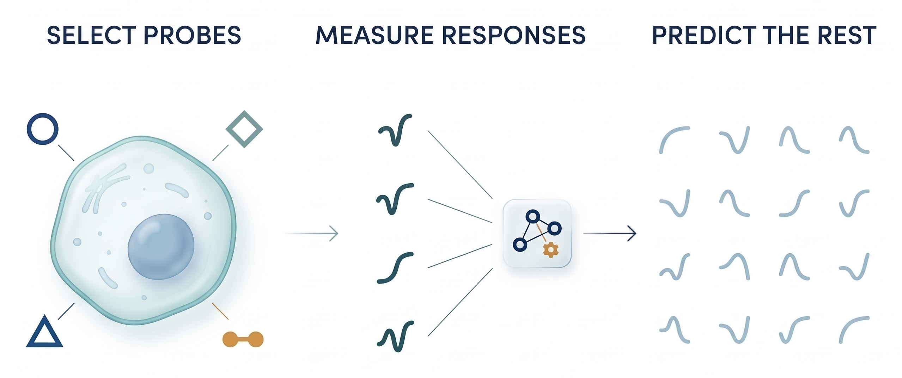
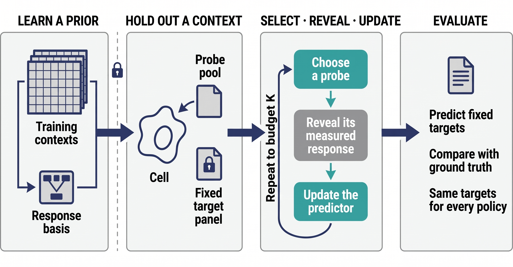
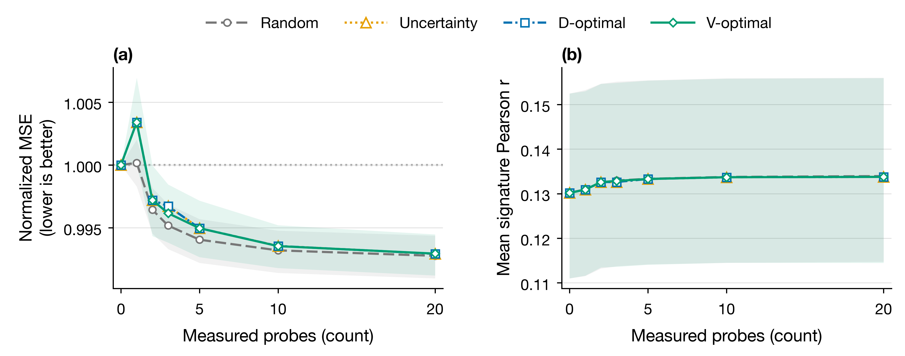
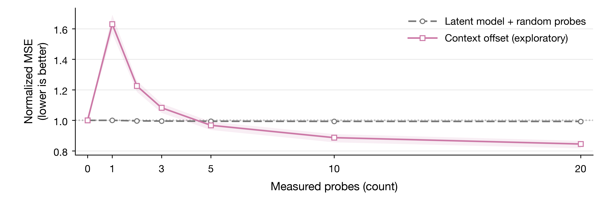

# How Many Experiments Does a Virtual Cell Need?

## Abstract

Virtual-cell models must predict perturbation responses in biological contexts that were absent during training. CELL-ID investigates whether carefully chosen calibration experiments can improve this transfer more efficiently than random experiments. We implemented a retrospective, leakage-controlled pilot using author-released Tahoe-100M drug-response signatures from ten cancer cell lines and 58 shared drugs at 0.05 µM on one experimental plate. Figure 1 illustrates the motivating concept. Each evaluation fold withheld an entire cell line. Twenty-nine drugs formed a probe pool, while twenty-nine separate drugs remained fixed evaluation targets. Training-only gene selection and nested context validation defined a low-rank Gaussian response model. Acquired signatures updated its latent context estimate. We compared random probes, uncertainty sampling, D-optimal information gain and V-optimal predictive-variance reduction across budgets from zero to twenty probes. Missing estimates were preserved and excluded only through documented observation masks. Five V-optimal probes produced mean normalized prediction error of 0.99497, compared with 0.99405 for random probes and 1.00000 without adaptation. The three informed designs selected identical five-probe sets in all ten contexts. An exploratory context-offset predictor, using the same random probes, achieved 0.96753 at five probes and 0.84500 at twenty, although it worsened performance at lower budgets. These results favor improving the transferable predictor before asserting benefits from optimized acquisition. This pilot establishes neither dramatic experimental savings nor a complete virtual cell. Shared experimental structure, limited context coverage and unverified source preprocessing restrict interpretation. Future PRISM models require rigorous independent-dataset replication and reliable uncertainty calibration, with simple adaptation baselines retained throughout future method development.

## 1. Introduction and Objectives

A new cell type or tumour context may respond differently from familiar cell lines to the same compound. Measuring every possible perturbation is expensive; predicting the unmeasured responses is therefore an important objective in computational biology. The Tahoe-100M atlas contains experimentally measured drug-response transcriptomes across many cancer contexts [1], but the present investigation concerns a narrow, documented subset. It asks a concrete experimental-design question: when an entirely held-out cell context can be measured under only a few chosen drugs, do informed choices improve predictions for drugs that remain unmeasured?

This question differs from ranking drugs by therapeutic effect. The objective is reconstruction of *transcriptomic response signatures*, not clinical efficacy. It also differs from prediction for entirely unknown drugs: drug identities in the test context have been measured in training contexts. The primary hypothesis was that acquiring probes predicted to reduce uncertainty across an independent panel of target drugs would outperform acquiring the same number of probes randomly. The original analysis evaluates that hypothesis; a separately identified exploratory analysis tests whether a simpler predictor changes the answer.

## 2. Related Work and Contribution

Perturbation models have often been assessed using expression-level errors that can reward common, context-wide effects rather than the specific effect of an intervention. Ahlmann-Eltze, Huber and Anders [2] showed that simple linear baselines remained competitive with several more complex models in their genetic-perturbation benchmarks. That result motivates explicit baselines in this chemical-perturbation pilot; it does not imply the same method always wins in every setting.

Few-shot transfer to previously unseen cellular contexts is already an active research direction. C3TL [3] specifically studies cellular-context transfer and limited-data conditions. Active learning for biological perturbation experiments also has established precedents: for example, NAIAD [4] focuses on selecting useful combinatorial gene perturbations. This project therefore does not claim to invent either few-shot context transfer or active biological experimentation. Its contribution is a controlled comparison of inexpensive selection rules under the same predictor, the same fixed target drugs and an explicit acquisition budget. The primary outcome is negative, which is scientifically relevant because it tests the assumption that a theoretically informative probe must yield better real-data reconstruction.

The proposed broader system, sometimes described as PRISM, would include learned drug representations, context encoders and an outcome-adaptive acquisition policy. None of these nonlinear components was implemented in this study. The tested model is linear, Gaussian and static. D-optimal and V-optimal are standard experimental-design principles applied here to a learned response basis, not newly derived optimization algorithms.

## 3. Materials and Methods

### 3.1. Data source, response definition and eligibility

The analysis uses the publicly released Tahoe-100M `pseudobulk_differential_expression` tables at a recorded dataset revision [1]. From the available downloaded shards, ten contexts—A549, COLO 205, HT-29, HS-578T, LoVo, RKO, SW480, SHP-77, SW1417 and SW 900—had 58 common drugs at 0.05 µM on plate 1. This gives 580 context–drug signatures. Each retained profile had at least 50 treatment and 50 control cells; observed counts actually ranged from 295 to 10,286 treated cells and from 1,805 to 10,609 control cells. Those cell counts should not be mistaken for independent biological replicates.

The source tensor has 62,710 gene names; 16,447,466 published log2 fold-change entries are finite and 19,924,334 are missing. Missing entries remained missing; neither a zero response nor a synthetic measurement replaced them. The response used for modeling is the *author-released* log2 fold-change estimate, not a reconstructed difference between sample means. The raw untreated-expression vector is unavailable in these tables, and the source's exact differential-expression preprocessing, control pooling and treatment duration could not be confirmed from accessible documentation. These conditions limit biological interpretation even though source values were independently matched to the published files.

The extracted subset follows a bounded source-shard and eligibility process; it is not a random sample of Tahoe-100M. Consequently, all performance estimates refer to these ten contexts and this 58-drug panel at one concentration and plate. Source-data provenance, exact files, hashes and verified extraction are retained alongside the reproducible scripts.

### 3.2. Context holdouts and fixed evaluation panel

Ten outer experiments each held out *all* responses of one cell context while fitting the model on the other nine. The identities of 29 drugs were assigned to a possible probe pool, and the remaining 29 drugs formed an independent, fixed evaluation panel. The identifier-only split used seed 20261002 and was reused across contexts and methods. When a method requested a probe, the corresponding pre-existing experimental signature and its gene-availability mask were revealed to the predictor. No laboratory experiment was newly performed.

The target panel's responses were hidden throughout gene selection, representation learning, hyperparameter selection, probe choice and context adaptation. The target set was held constant at every budget and for every acquisition policy: otherwise an algorithm could appear successful merely because it had chosen difficult targets and removed them from scoring. This design tests generalization across cellular *contexts* for drug identities known from training contexts. It does not assess unknown compounds, drug combinations or doses beyond 0.05 µM.

### 3.3. Transferable response model

Feature selection was performed separately inside each outer training fold. Genes were eligible only when their released fold-change estimates were finite across all training context–drug profiles. Up to 1,000 eligible genes with the largest across-context residual variation were retained. The held-out context's values and missingness played no part in this selection. The same procedure was repeated inside inner context holdouts for hyperparameter choice.

Let \(y_p\) denote the selected-gene response vector for drug \(p\). A training-context mean \(\mu_p\) and low-rank loadings \(A_p\) define the linear context-response model

$$
y_p = \mu_p + A_p z + \varepsilon_p,\quad z\sim\mathcal{N}(0,I),\quad \varepsilon_p\sim\mathcal{N}(0,\tau^2 I).
$$

Here \(z\) is an unknown latent descriptor of the held-out cell context. The \(A_p\) matrices arise from the training contexts' residual covariance. A Gaussian prior and an effective noise term regularize identification of \(z\) from sparse observations; \(\tau\) is a model-discrepancy parameter, *not* an independently estimated biological-replicate variance. For acquired probes \(S\), only observed genes contribute to posterior precision and mean:

$$
\Lambda_S=I+\frac{1}{\tau^2}\sum_{p\in S}A_{p,\mathrm{obs}}^\top A_{p,\mathrm{obs}},
$$

$$
b_S=\frac{1}{\tau^2}\sum_{p\in S} A_{p,\mathrm{obs}}^\top\left(y_{p,\mathrm{obs}}-\mu_{p,\mathrm{obs}}\right),
\qquad m_S=\Lambda_S^{-1}b_S,\qquad \mathbb{E}[y_q\mid S]=\mu_q+A_qm_S.
$$

Inner context holdouts selected rank from 2, 4 and 8 (subject to available context rank) and an effective noise multiplier from 0.1, 1 and 10. They scored five random probes across three seeds without consulting the outer test context. Each completed outer fit used 1,000 genes, rank seven and noise multiplier 10. A small posterior variance is a property of the fitted model and must not be confused with demonstrated uncertainty calibration.

### 3.4. Probe selection and comparison policies

Policies were compared at budgets 0, 1, 2, 3, 5, 10 and 20 distinct acquired aggregate signatures. At budget zero the prediction is the training-context drug mean. Random acquisition draws a permutation of the 29 possible probes; 20 fixed random seeds are averaged within each held-out context. The other three policies greedily choose the currently highest-scoring candidate using the same trained predictor: uncertainty sampling seeks large nominal response variance, D-optimal selection seeks the largest increase in log-determinant posterior precision, and V-optimal selection seeks the largest reduction in the sum of predicted variances over the 29 fixed target identities.

For an unqueried candidate, acquisition uses the training-derived nominal full-gene design because its held-out gene-availability mask is unknown. Once queried, the actual observed-gene rows update the posterior. Later choices may therefore react to acquired *missingness*. In this Gaussian model their variance-based scores do not depend on the observed expression-change magnitudes. This is a sequential experimental-design implementation, not a learned outcome-adaptive policy. Greedy D-optimal selection is not an exact global optimization over all drug subsets.

### 3.5. Outcomes, uncertainty and implementation checks

The primary metric is the mean squared prediction error on finite, held-out target-gene entries, divided by the same context's unadapted training-mean error. One is the no-probe reference; smaller values are better. The same observed target-gene mask is used by every method. A secondary metric averages the gene-wise Pearson correlation between measured and predicted log2 fold-change signatures over target drugs, then contexts. The normalized area under the error-versus-budget curve uses trapezoids at the actual budgets and divides by the maximum budget, 20.

The unit of analysis is the held-out cell context—not a gene, individual cell or random seed. For comparisons, random-seed scores are averaged within each context first. Descriptive 95% uncertainty bands are percentile intervals from 2,000 paired context bootstrap samples, seed 77. Since the ten held-out folds share training contexts and experimental preparation, these intervals do not support independent-cohort population claims; no confirmatory p-value is reported.

Saved primary results were independently reconstructed from raw prediction checkpoints. Checks covered 1,680 metrics, 40 full predictor reconstructions and 230 acquisition sequences. A hidden-response sentinel established that changing unqueried target values or their missingness could not change fitted parameters, selected probes or predictions. Source extraction was also verified against all 36,371,800 retained gene-profile rows, including missing fold-change and standard-error entries.

### 3.6. Exploratory simple adaptation comparator

Only after completing the primary comparison was a simpler response predictor tested. For each gene, it computes the mean acquired-probe residual relative to its training drug mean and adds that offset to the training mean of each target drug. A gene with no observed acquired residual receives a zero correction. This comparator was evaluated without post hoc tuning, using exactly the same training-selected genes, fixed targets, observed masks and 20 *matched* random acquisition orders. It changes the prediction rule rather than the probe ordering, allowing a simple model-capacity diagnostic. It is exploratory, not a preregistered primary policy.

## 4. Results

### 4.1. Primary acquisition comparison

At five probes, all informed methods selected identical five-drug sets in every one of the ten contexts. Their normalized error was 0.994967, whereas random probes reached 0.994055. Both are close to the no-probe reference of one. At twenty probes, V-optimal reached 0.992947 and random reached 0.992770. Measured signature correlations were also low: approximately 0.130 without adaptation and 0.133 with five probes.

| Probe policy | Error, five probes | Pearson r, five probes | Error, twenty probes | Error AUC |
|---|---:|---:|---:|---:|
| Training mean | 1.000000 | 0.130167 | 1.000000 | 1.000000 |
| Random | 0.994055 | 0.133325 | 0.992770 | 0.994073 |
| Uncertainty | 0.994967 | 0.133290 | 0.992934 | 0.994721 |
| D-optimal | 0.994967 | 0.133290 | 0.992934 | 0.994721 |
| V-optimal | 0.994967 | 0.133290 | 0.992947 | 0.994678 |

The paired context-average gain defined as random error minus V-optimal error at five probes was −0.000912508; its descriptive 95% context-bootstrap interval was [−0.001646702, −0.000285051]. A negative value favors random acquisition. The finding does not justify an efficiency claim for designed probes, despite the mathematical rationale for D- and V-optimal acquisition. Figure 3 shows the measured budget curves and their descriptive context intervals; overlapping informed-policy curves reflect almost identical observed performance, not omitted data.

### 4.2. Exploratory context-offset comparator

The simpler gene-wise context-offset predictor achieved lower error than the latent model with the same random probe orders once at least five measurements were available. At five probes it reached 0.967533, compared with 0.994055 for the latent model. At twenty probes it reached 0.844995, compared with 0.992770. Yet it was *worse* than the unadapted reference at one, two and three probes. The result therefore depends strongly on the experimental budget.

| Measured probes | Context-offset normalized error |
|---:|---:|
| 0 | 1.000000 |
| 1 | 1.630434 |
| 2 | 1.225142 |
| 3 | 1.082470 |
| 5 | 0.967533 |
| 10 | 0.886650 |
| 20 | 0.844995 |

The paired primary-random-minus-offset difference at five probes was 0.026521, with a descriptive 95% context-bootstrap interval of [0.001995, 0.057268]. Individual context-offset errors still ranged from 0.866915 to 1.025950 at five probes. These results support comparing learned response bases against inexpensive context correction; they do not establish that the offset is reliable for a single new context or for one to three experiments.

## 5. Discussion

The proposed system-identification intuition is valuable only if a learned representation connects informative probe responses to the unmeasured targets. Here the latent Gaussian model obtained a modest benefit from adaptation, but its theory-driven choices did not beat random acquisition. The three design rules even chose identical five-probe panels in every context. This can occur if the fitted low-dimensional basis assigns most candidate drugs similar latent information or if optimization objectives are dominated by shared directions. No unmeasured pathway mechanism was inferred from this coincidence.

The exploratory simple baseline offers a second lesson. A context-wide gene response offset can be easier to estimate and more useful than a restricted response basis at larger budgets. On the other hand, its large one-probe error shows the danger of treating a noisy calibration response as a reliable universal correction. Future modeling work should benchmark and, where appropriate, regularize such offsets before adding complex selection networks. A nonlinear response model and an outcome-sensitive policy could make different choices, but that claim requires a new experiment, not extrapolation from the current plots.

There are important boundaries to these conclusions. Only ten selected cell lines and 58 shared drugs were included, all at one concentration on one plate. The drug panel is mechanism-unbalanced and the held-out contexts share upstream experimental conditions. Source differential-expression preprocessing and exposure duration remain unverified. Complete training-gene eligibility restricts evaluated genes to a reproducible subset. A gene-wise squared error or correlation does not by itself show recovery of drug-specific differentially expressed genes, pathways, dose-response surfaces or cellular dynamics. The method has not been tested on primary tumour samples, new drugs, combinations or an independent dataset. Model-derived covariance should not be presented as calibrated biological confidence.

IRIS's scientific-research emphasis makes it especially important to distinguish computational experiments on already-collected public measurements from prospective wet-lab experiments. This work simulates allowed acquisitions by revealing stored signatures and checks predictions against stored ground truth. The biology is real experimental data, but the selection policy was not deployed to choose new laboratory assays. The study provides a reproducible falsifiable baseline and diagnostic result, not clinical readiness.

## 6. Conclusion

Under a fixed 29-drug probe pool and 29-drug target panel, the tested linear-Gaussian approach did not identify advantageous drugs to measure in a previously held-out cell line. Five V-optimal probes produced slightly worse normalized prediction error than five random probes. An exploratory, simpler context-offset correction made larger-budget predictions better but failed at smaller budgets. The next decisive test should improve the predictor and evaluate it alongside simple calibration methods on independent datasets and more balanced drug panels, while preserving hidden-target acquisition rules. The number of experiments a virtual cell needs remains an empirical question, not a headline fixed by this pilot.

## Acknowledgements

The public Tahoe-100M dataset and its authors are acknowledged [1]. AI tools assisted with literature organization, code, manuscript drafting and conceptual diagrams. Performance plots are generated from public experimental measurements using saved analysis scripts. No unverified project mentor, institutional support, funding, original wet-lab contribution or clinical involvement is claimed.

## References

[1] Zhang, J., Ubas, A. A., Svensson, V., et al. (2026). Tahoe-100M: Mapping drug-induced molecular phenotypes at single-cell resolution. *Cell*, 189(19), 5945–5961.e8. https://doi.org/10.1016/j.cell.2026.08.035. Dataset: https://huggingface.co/datasets/tahoebio/Tahoe-100M.

[2] Ahlmann-Eltze, C., Huber, W. and Anders, S. (2025). Deep-learning-based gene perturbation effect prediction does not yet outperform simple linear baselines. *Nature Methods*, 22, 1657–1661. https://doi.org/10.1038/s41592-025-02772-6.

[3] Scholkemper, M. and Mukherjee, S. (2026). Causal Cellular Context Transfer Learning (C3TL): An Efficient Architecture for Prediction of Unseen Perturbation Effects. *arXiv* preprint 2603.13051. https://arxiv.org/abs/2603.13051.

[4] Qin, J., Wessels, H.-H., Fernandez-Granda, C. and Hao, Y. (2024). Active learning for efficient discovery of optimal gene combinations in the combinatorial perturbation space. *arXiv* preprint 2411.12010v2, AI for New Drug Modalities at NeurIPS 2024 workshop. https://arxiv.org/abs/2411.12010.

## Appendix A. Reproducibility and provenance

Data sources and missing methods are documented in `notes/data_provenance.md` and `data/source_manifest_public.tsv`. Scripts `prepare_data.py`, `run_pilot.py` and `check_pilot.py` provide extraction, analysis and independent verification; `context_shift_baseline.py` verifies the exploratory comparison. Model selections, masked predictions and metrics are saved in `results/pilot/main/`; exploratory scores are saved separately in `results/pilot/context_shift/`. Plot values and reproduction code are in `figures/paper/` and `figures/plot_paper_figures.py`. All computations ran locally. Reruns use a new output directory to preserve the verified experiment.

The frozen input is the dataset `tahoebio/Tahoe-100M`, configuration `pseudobulk_differential_expression`, revision `2dc57900b7981cfcf5e211527169a0b006546a95`; the extracted response tensor has SHA-256 `afbc9c8ba914d49603b45b34b1c71784539b90365403a4bee650846e62fba750`. Source-file URLs and hashes, license, eligible context/drug identities, and complete gene-row comparisons are recorded in the source manifest. The extracted tensor retains published fold-change values and missingness without numerical imputation. Its row-wise reindexing against the downloaded source passed for 36,371,800 values, counting both finite and unavailable entries.

The primary drug partition seed is 20261002. Twenty random acquisition orders are averaged within each held-out context. Training-only gene eligibility and ranking are repeated in every outer and inner fold. Model selection uses five random probes, three inner random seeds and the stated rank/noise grid. The held-out context's 29 target signatures are never available to fitting or probe choice. Model checks reconstructed 1,680 recorded metrics, 40 full prediction checkpoints and 230 masked acquisition sequences; maximum absolute MSE discrepancy was 4.44 × 10⁻¹⁶. Separate comparator checks reconstructed 1,400 metric rows and 30 checkpoints. The descriptive context bootstrap uses 2,000 resamples with seed 77. These implementation checks establish reproducibility and leakage control for this dataset; they do not certify that the source's biological preprocessing or model noise assumptions are correct.
